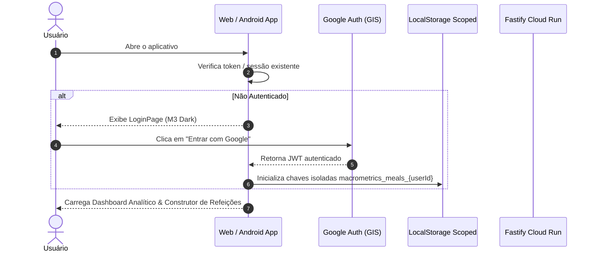

# Primeiros Passos & Autenticação

O **MacroMetrics Pro** é uma plataforma focada em tomada de decisão alimentar analítica para atletas de força e indivíduos focados em composição corporal.

Diferente de contadores de calorias passivos que apenas registram o que já foi ingerido, o MacroMetrics Pro atua como um **conselheiro matemático proativo**, alertando antes de deslizes ocorrerem.

---

## 🔒 Acesso Obrigatório por Login

Para garantir o isolamento estrito de dados, a conformidade com a LGPD e o controle personalizado de metas, **o usuário só é capaz de visualizar o diário e lançar alimentos se estiver autenticado**.

### Tela Inicial de Login (Web e Android)
Ao abrir a aplicação sem uma sessão ativa, tanto na versão Web (PWA) quanto no aplicativo nativo Android, o usuário é recepcionado pela página de login analítica:

- **Autenticação Exclusiva Google Auth:** Não há senhas locais, eliminando riscos de vazamento de credenciais fracas.
- **Identificação Pseudo-Anonimizada:** O e-mail e o ID do usuário nunca são expostos em texto plano, utilizando *Blind Indexing* (HMAC-SHA256 com Pepper seguro).
- **Garantias LGPD Explícitas:** Avisos transparentes sobre a criptografia dos dados biométricos e canal direto de autoatendimento para exclusão de conta em até 15 dias úteis.

---

## 🎯 Configuração do Perfil e Controle Individual de Macros

Cada usuário cadastrado possui autonomia total sobre suas metas diárias. Clicando no botão **"Controlar Macros"** no cabeçalho:

1. **Ajuste Biométrico:** Configuração de peso, altura, idade, sexo biológico e nível de atividade física.
2. **Cálculo da Taxa Metabólica Basal (Mifflin-St Jeor):** O sistema calcula o TDEE / GET automaticamente.
3. **Fibras Recomendadas por Idade:** Ao alterar a idade, o sistema recalcula e sugere a meta de fibras recomendada pela Dietary Reference Intakes (DRI):
   - **Homens de 19 a 50 anos:** 38g/dia
   - **Homens acima de 50 anos:** 30g/dia
   - **Mulheres de 19 a 50 anos:** 25g/dia
   - **Mulheres acima de 50 anos:** 21g/dia
4. **Metas Personalizáveis:** Calorias, Proteínas (g), Carboidratos (g), Gorduras (g) e Fibras (g).

---

## 📱 Instalação no Desktop e Celular

- **Web / Desktop (Chrome, Edge, Safari):** Instalável como **Progressive Web App (PWA)** com suporte offline integral via Service Worker.
- **Mobile (Android / iOS):** Encapsulado via **Capacitor 6**, permitindo integração direta com recursos nativos do dispositivo.
